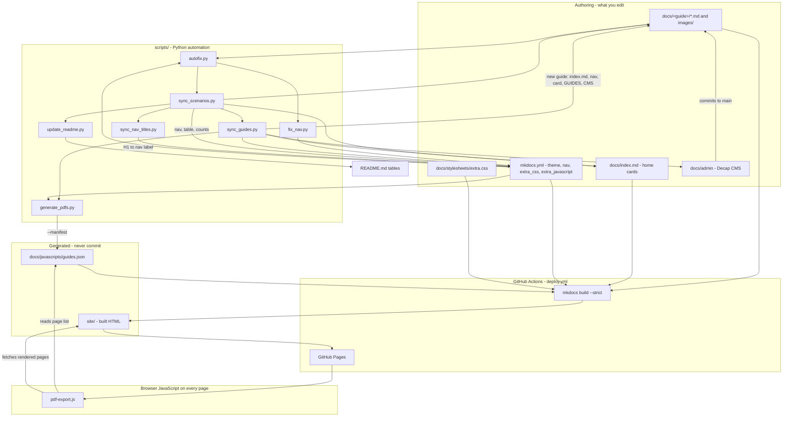
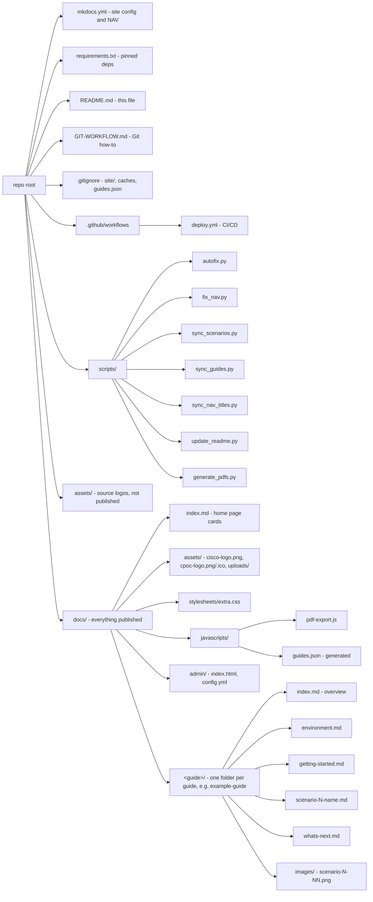
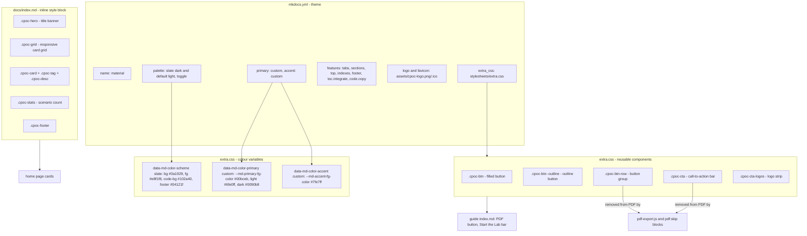
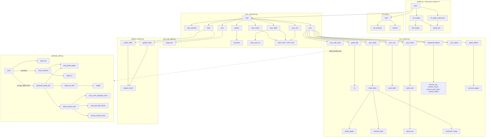
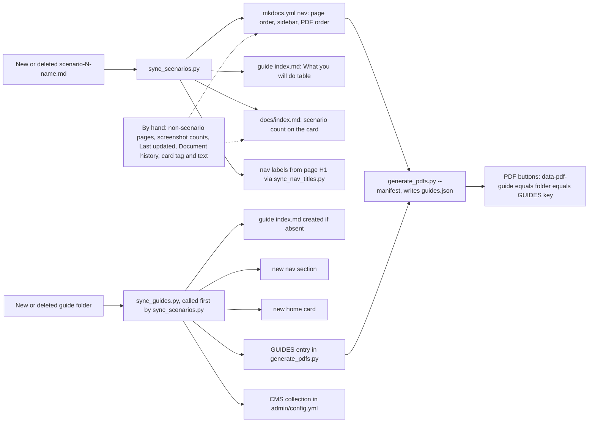
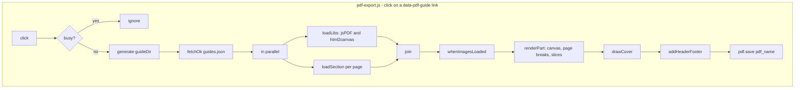
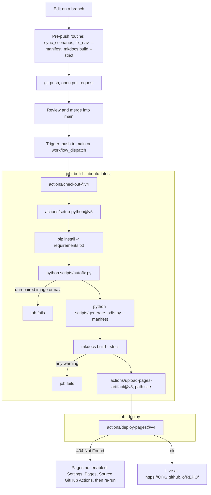

# CPOC Lab Guides — Master Template

A **blank, reusable copy** of the CPOC lab-guide website infrastructure. It contains no lab content, only
the build system, theme, PDF export, automation scripts and one small **example guide**
(`docs/example-guide/`) that shows the page structure. Use it as the master repo: clone it (or click
**Use this template** on GitHub) every time you need a new, independent lab-guide site.

It is a [MkDocs](https://www.mkdocs.org/) + [Material](https://squidfunk.github.io/mkdocs-material/)
static site, deployed to GitHub Pages by GitHub Actions on every push to `main`. Everything is plain
Markdown: no database, no server.

**New here?** Start with [§12 New user guide](#12-new-user-guide-where-to-add-directories-images-and-scenarios).

| Document | Read it for |
|---|---|
| **this README** | Replicating the template, repo layout, writing guides, scripts, troubleshooting |
| [GIT-WORKFLOW.md](GIT-WORKFLOW.md) | Step-by-step Git: clone, edit, add, delete, rename, push, pull request, merge, conflicts, undo |

## Contents

1. [Replicate this template for a new project](#1-replicate-this-template-for-a-new-project)
2. [Customize the template (checklist)](#2-customize-the-template-checklist)
3. [Repository layout](#3-repository-layout)
4. [Writing guides](#4-writing-guides)
5. [Automation scripts and CI](#5-automation-scripts-and-ci)
6. [Run locally](#6-run-locally)
7. [Publish to GitHub Pages](#7-publish-to-github-pages)
8. [Keeping a project up to date with the template](#8-keeping-a-project-up-to-date-with-the-template)
9. [Troubleshooting](#9-troubleshooting)
10. [Known limitations](#10-known-limitations)
11. [Complete repository flowchart](#11-complete-repository-flowchart) (directory, styling, Python functions, index, CI)
12. [New user guide: where to add directories, images and scenarios](#12-new-user-guide-where-to-add-directories-images-and-scenarios)
13. [Code signature and credits](#13-code-signature-and-credits)

---

## 1. Replicate this template for a new project

Pick **one** of the two options. Option A is easier; Option B works for any Git host.

### Option A — GitHub "Use this template" (recommended)

1. Push this repo to GitHub (see [GIT-WORKFLOW.md §1](GIT-WORKFLOW.md#1-one-time-setup)).
2. On GitHub: **Settings → General → check "Template repository"**.
3. For each new project: open the repo and click **Use this template → Create a new repository**.
   The new repo starts with a clean history and no link back to the template.
4. Clone your new repo and continue with [§2](#2-customize-the-template-checklist).

### Option B — Clone and re-point the remote

```bash
# 1. Clone the master template into a folder named after the new project
git clone https://github.com/<ORG>/<TEMPLATE-REPO>.git my-new-lab-guides
cd my-new-lab-guides

# 2. (Optional) start with a clean history instead of the template's history
rm -rf .git                      # PowerShell: Remove-Item -Recurse -Force .git
git init -b main
git add .
git commit -m "Initial commit from CPOC master template"

# 3. Create an EMPTY repo on GitHub (no README/.gitignore), then connect and push
git remote add origin https://github.com/<ORG>/my-new-lab-guides.git
git push -u origin main
```

If you want to **keep** the template history and the ability to pull template improvements, skip step 2
and instead rename the remotes:

```bash
git remote rename origin template
git remote add origin https://github.com/<ORG>/my-new-lab-guides.git
git push -u origin main
```

See [§8](#8-keeping-a-project-up-to-date-with-the-template) for pulling later template changes.

---

## 2. Customize the template (checklist)

Search for the word `TEMPLATE` and for `Your Name` / `you@example.com` / `YOUR-ORG` to find every spot.

| # | File | Change |
|---|---|---|
| 1 | `mkdocs.yml` | `site_name`, `site_description`, `site_author` |
| 2 | `docs/index.md` | Hero title and sentence, footer name/email, one card per guide |
| 3 | `docs/admin/config.yml` | `repo: YOUR-ORG/YOUR-REPO` and `base_url` (only if you use the Decap CMS; otherwise delete `docs/admin/`) |
| 4 | `scripts/sync_guides.py` | `AUTHOR, EMAIL` — used when a new guide is generated |
| 5 | `scripts/generate_pdfs.py` | `GUIDES` entries: cover title, subtitle, date, author, email |
| 6 | `docs/assets/`, `assets/` | Replace `cisco-logo.png`, `cpoc-logo.png`, `cpoc-logo.ico` with your logos (same file names) |
| 7 | `docs/stylesheets/extra.css` | Brand colours (optional) |
| 8 | `docs/javascripts/pdf-export.js` | Cover/header/footer wording in `drawCover` and `addHeaderFooter` (optional) |
| 9 | `docs/example-guide/` | Rename, rewrite or delete (see [§4.3](#43-add-a-whole-new-guide-or-remove-the-example)) |

---

## 3. Repository layout

```
.
├── mkdocs.yml                      # Site config + NAV (single source of truth for page order)
├── requirements.txt                # Pinned Python dependencies
├── README.md                       # This file
├── GIT-WORKFLOW.md                 # Git instructions: clone/edit/add/delete/push/merge
├── .gitignore                      # site/, caches, generated docs/javascripts/guides.json
├── .github/workflows/deploy.yml    # CI: autofix -> manifest -> mkdocs build --strict -> deploy
├── scripts/                        # Automation (see §5)
├── assets/                         # Repo-level source assets (NOT published)
└── docs/                           # Everything below is published
    ├── index.md                    # Home page (one card per guide)
    ├── assets/                     # Published logos/favicon (+ uploads/ for CMS media)
    ├── stylesheets/extra.css       # Theme colours and .cpoc-* components
    ├── javascripts/
    │   ├── pdf-export.js           # Builds PDFs in the browser on click
    │   └── guides.json             # GENERATED (gitignored)
    ├── admin/                      # Decap CMS (optional web editor)
    └── example-guide/              # EXAMPLE guide — one folder per guide
        ├── index.md                # Overview
        ├── environment.md          # IPs, credentials, equipment
        ├── getting-started.md
        ├── scenario-1.md … scenario-3.md
        ├── whats-next.md
        └── images/                 # Screenshots: scenario-<N>-<NN>.png
```

---

## 4. Writing guides

### 4.1 Page conventions

- One `# H1` per page; sections with `##` / `###`.
- Scenario pages are named `scenario-<N>*.md` and start with `# Scenario N - Title`.
- A guide's `index.md` starts with `# Title`, then the italic subtitle line, then author/version/date
  (the PDF removes the first two because the cover already shows them).
- Screenshots: put them in the guide's `images/` folder, named `scenario-<N>-<NN>.png`, and reference them
  with a **relative** path: ``. Never use absolute or Windows paths.
- Callouts: `!!! note "Title"` (also `tip`, `warning`, `danger`). Collapsible: `??? note "Title"`.
- Links between pages are relative `.md` links: `[Scenario 2](scenario-2.md)`.
- Web-only blocks (buttons, call-to-action bars) go inside `<!-- pdf:skip:start --> … <!-- pdf:skip:end -->`.

### 4.2 Add, edit, rename, delete a page

| Task | Steps |
|---|---|
| **Edit** | Edit the `.md` file, commit, push. |
| **Add a scenario** | Create `docs/<guide>/scenario-<N>-name.md` (first line `# Scenario N - Title`) and its images, then run `python scripts/sync_scenarios.py`. It adds the page to the nav, the guide's "What you'll do" table and the home-page scenario count. |
| **Add any other page** | Create the file and add one line to the `nav:` in `mkdocs.yml`, in reading order: `- My Page: example-guide/my-page.md`. |
| **Rename / move** | Use `git mv old.md new.md`, then `python scripts/fix_nav.py`, then `mkdocs build --strict` and fix any in-page links it reports. |
| **Delete** | Delete the file (`git rm`), then run `python scripts/sync_scenarios.py` (scenario pages) or remove its nav line by hand; remove links to it; run `mkdocs build --strict`. |

### 4.3 Add a whole new guide (or remove the example)

1. Create `docs/<new-guide>/` (lowercase, hyphens) with at least one `scenario-1-name.md`
   (an `index.md` is optional; it will be generated).
2. Run `python scripts/sync_scenarios.py`. It generates, in the style of the example guide:
   `index.md` (if absent), the `mkdocs.yml` nav section, the home-page card, the `GUIDES` entry in
   `scripts/generate_pdfs.py`, and the CMS collection in `docs/admin/config.yml`.
3. Edit the generated About/Scope text, the card tag/description and the PDF cover subtitle.
4. To **remove the example guide**: delete `docs/example-guide/` and run `python scripts/sync_scenarios.py`;
   it removes the nav section, card, `GUIDES` entry and CMS collection for you.
5. Run the pre-push routine below, then commit.

### 4.4 Pre-push routine

```bash
python scripts/sync_scenarios.py       # nav, indexes, counts, README tables
python scripts/fix_nav.py              # repair renamed pages in nav
python scripts/generate_pdfs.py --manifest
mkdocs build --strict                  # any warning (broken link/image/nav) = failure
```

`mkdocs build --strict` is the single best check; CI runs the same command and refuses to deploy if it fails.

---

## 5. Automation scripts and CI

<!-- auto:guides:start -->
| Guide | Folder | Scenarios | Nav section label in `mkdocs.yml` |
|---|---|---|---|
| Example Guide | `docs/example-guide/` | 3 | `Example Guide` |
<!-- auto:guides:end -->

<!-- auto:scripts:start -->
| Script | What it does |
|---|---|
| `scripts/autofix.py` | Repair the common mistakes that break `mkdocs build --strict`, then sync nav/indexes. |
| `scripts/fix_nav.py` | Auto-fix mkdocs.yml nav entries that point at renamed/moved pages. |
| `scripts/generate_pdfs.py` | Generate guide PDFs (offline) and the guides.json manifest used by the site's PDF buttons. |
| `scripts/sync_guides.py` | Detect new guide folders under docs/ and register them everywhere, in the existing style. |
| `scripts/sync_nav_titles.py` | Keep mkdocs.yml nav labels for scenario pages in sync with each page's H1. |
| `scripts/sync_scenarios.py` | Pick up new scenario pages and update the nav and index files to match. |
| `scripts/update_readme.py` | Regenerate the auto-maintained tables in README.md. |
<!-- auto:scripts:end -->

> The tables above are regenerated by `python scripts/update_readme.py`; do not edit the text between the
> `<!-- auto:... -->` markers by hand.

`.github/workflows/deploy.yml` runs on every push to `main` (and manually via **Actions → Run workflow**):

```
checkout → python 3.x → pip install -r requirements.txt → scripts/autofix.py
        → scripts/generate_pdfs.py --manifest → mkdocs build --strict → upload site/ → deploy to Pages
```

> Fixes that `autofix.py` applies in CI affect only that run's copy of the files. Run the pre-push
> routine locally and **commit the result** so the repository stays correct.

**PDF export:** every `[PDF](#){ .cpoc-btn data-pdf-guide="<guide-folder>" }` link builds that guide's PDF
in the visitor's browser from `docs/javascripts/guides.json` (generated from the nav). Keep the `(#)` target
and make `data-pdf-guide` equal the folder name and the `GUIDES` key. For searchable offline PDFs:
`playwright install chromium && python scripts/generate_pdfs.py`.

**Invariants that break the deploy if violated**

| Requirement | Enforced by |
|---|---|
| Every nav path exists under `docs/` | `fix_nav.py`, `--strict` |
| `GUIDES[...]["nav_label"]` equals the exact nav section title | `generate_pdfs.py --manifest` |
| `GUIDES` key = folder name = `data-pdf-guide` value | `pdf-export.js` ("Unknown guide") |
| Image paths are relative and the files exist | `--strict` |
| `pdf-export.js` stays in `extra_javascript` | `mkdocs.yml` |
| `docs/javascripts/guides.json` is generated, never committed | `.gitignore` |

---

## 6. Run locally

```bash
python -m venv .venv
.venv\Scripts\activate              # Windows   (macOS/Linux: source .venv/bin/activate)
pip install -r requirements.txt

python scripts/generate_pdfs.py --manifest   # once, and after nav changes (needed for PDF buttons)
mkdocs serve                                  # http://127.0.0.1:8000  (live reload)
```

Open the site through `mkdocs serve`, not by double-clicking `site/index.html`.

---

## 7. Publish to GitHub Pages

**Do this once for every new repo, before the first deploy.** The Pages setting is *not* copied when you
use the template, and without it the `deploy` job fails (see the error below).

1. Push the repo to GitHub on branch `main`.
2. Open `https://github.com/<ORG>/<REPO>/settings/pages`
   (**Repo → Settings → Pages**).
3. Under **Build and deployment → Source**, choose **GitHub Actions** (not "Deploy from a branch").
4. Run the workflow: **Actions → Deploy MkDocs site to Pages → Run workflow** (or push any commit to `main`).
5. Wait for both jobs (`build`, `deploy`) to turn green. The URL is shown on the `deploy` job and under
   Settings → Pages: `https://<ORG>.github.io/<REPO>/`.

**If you skip step 3** the `build` job passes but `deploy` fails with:

```
Error: Creating Pages deployment failed
Error: HttpError: Not Found
Error: Failed to create deployment (status: 404) ... Ensure GitHub Pages has been enabled:
https://github.com/<ORG>/<REPO>/settings/pages
```

Fix: do steps 2-4 above and re-run the failed workflow (**Actions → the failed run → Re-run all jobs**).
The `punycode DeprecationWarning` printed at the top of the log is a harmless Node warning from the action.

**If "GitHub Actions" is not offered or Pages is greyed out:**

- Private repos need a GitHub plan that supports private Pages; on a free plan make the repo public or upgrade.
- An organization owner may have restricted Pages: check the org's **Settings → Pages**, or ask an admin.
- Workflow permissions: **Settings → Actions → General → Workflow permissions** must allow the workflow to run
  (the workflow itself already requests `pages: write` and `id-token: write`).

Note: the template has **no login**. The published site is public on the internet for public repos; see [§10](#10-known-limitations) if you need access control.

---

## 8. Keeping a project up to date with the template

Only if you kept the template's history and named its remote `template` ([§1 Option B](#option-b--clone-and-re-point-the-remote)):

```bash
git fetch template
git switch -c chore/sync-template
git merge template/main --allow-unrelated-histories   # first time only; later: git merge template/main
# resolve conflicts (keep YOUR docs/ content, take the template's scripts/ and workflow), then:
git push -u origin chore/sync-template                 # open a pull request into main
```

Otherwise, copy the changed files in `scripts/`, `.github/`, `docs/javascripts/` and
`docs/stylesheets/` from the template by hand and commit them on a branch.

---

## 9. Troubleshooting

| Symptom | Cause | Fix |
|---|---|---|
| CI: `A reference to 'x.md' is included in the 'nav' … not found` | Page renamed/removed, nav not updated | `python scripts/fix_nav.py`, commit `mkdocs.yml` |
| CI: `Aborted with N warnings in strict mode` | Broken link or missing image | Read the warning and fix the path |
| CI: `Nav section not found: …` | `nav_label` in `GUIDES` differs from the nav section title | Make them identical |
| PDF button shows "PDF failed" | `guides.json` missing/404, page fetch failed, or CDN blocked | Run `generate_pdfs.py --manifest`; check the browser console |
| New page missing from sidebar/PDF | Not in the `mkdocs.yml` nav | Scenario page: run `sync_scenarios.py` (file must be `scenario-<N>…md`); other pages: add by hand |
| CMS cannot log in | `base_url` in `docs/admin/config.yml` is still the placeholder | Deploy an OAuth proxy and set it, or delete `docs/admin/` |
| Deploy job: `Creating Pages deployment failed … HttpError: Not Found (404)` | GitHub Pages not enabled on the repo (the build job is fine) | Settings → Pages → Source: **GitHub Actions**, then re-run the workflow ([§7](#7-publish-to-github-pages)) |
| Pages deploy is green but the site is a 404 | Pages source not set to GitHub Actions, or wrong URL | [§7](#7-publish-to-github-pages); use `https://<ORG>.github.io/<REPO>/` |
| Log shows `DeprecationWarning: The punycode module is deprecated` | Node warning inside the GitHub action | Ignore; it is not an error |

---

## 10. Known limitations

- **No authentication.** Anyone with the URL can read the site, and the Markdown/images are visible in the
  repo. For access control, use a private repo with private Pages (plan permitting) or host behind an
  authenticating proxy.
- **In-browser PDFs are image-based** (text not selectable) and need internet access to load jsPDF and
  html2canvas from cdnjs. The offline mode produces searchable PDFs.
- `sync_scenarios.py` only recognises files named `scenario-<number>*.md`.
- Screenshot counts, the "Last updated" date and Document history rows are maintained by hand.
- The Decap CMS edits only `title` and `body`; it does not update the nav.
- Material for MkDocs prints a warning about MkDocs 2.0; versions are pinned in `requirements.txt` so
  builds are unaffected until you choose to upgrade.

---

## 11. Complete repository flowchart

The diagrams below render on GitHub and in VS Code (Markdown preview with Mermaid support). They are
split by concern so each stays readable: 11.1 whole repo, 11.2 directory tree, 11.3 styling,
11.4 Python functions, 11.5 index, 11.6 browser JavaScript, 11.7 CI/CD.

### 11.1 Whole repository at a glance



### 11.2 Directory tree and what each part is for



### 11.3 Styling

All look-and-feel is the Material theme (`mkdocs.yml`) plus one override file, `docs/stylesheets/extra.css`.
Components are applied from Markdown with `attr_list` / `md_in_html`, e.g. `[Text](page.md){ .cpoc-btn }`.



To rebrand: change the three colour blocks in `extra.css` and replace the logo files (same names).

### 11.4 Python functions



| Script | Entry command | Key functions |
|---|---|---|
| `autofix.py` | `python scripts/autofix.py [--check]` | `fix_page_extensions`, `fix_images`, `find_image`, `guide_dirs`, `main` |
| `fix_nav.py` | `python scripts/fix_nav.py [--check]` | `git_renames`, `resolve`, `main` |
| `sync_scenarios.py` | `python scripts/sync_scenarios.py [--check]` | `scenarios`, `guides`, `sync_nav`, `sync_table`, `sync_home`, `warn_ignored`, `main` |
| `sync_guides.py` | `python scripts/sync_guides.py [--check]` | `sync`, `build_index`, `build_card`, `sync_index/nav/home/pdf_script/admin`, `remove_*`, `guide_title`, `main` |
| `sync_nav_titles.py` | `python scripts/sync_nav_titles.py [--check]` | `page_title`, `sync` |
| `update_readme.py` | `python scripts/update_readme.py [--check]` | `guides_table`, `scripts_table`, `replace_block`, `main` |
| `generate_pdfs.py` | `python scripts/generate_pdfs.py [--manifest]` | `load_nav`, `find_guide_pages`, `write_manifest`, `page_url`, `generate_guide_pdf`, `build_*_html`, `strip_*`, `rewrite_internal_links`, `main` |

### 11.5 The index - three things that must agree

"The index" is the **nav** in `mkdocs.yml`, the **home-page cards** in `docs/index.md`, and each guide's
**overview table** in `docs/<guide>/index.md`. A fourth copy, the `GUIDES` dict in `generate_pdfs.py`, feeds the PDF.



### 11.6 Browser JavaScript (PDF export)



### 11.7 CI/CD pipeline and Git flow



---

## 12. New user guide: where to add directories, images and scenarios

Read this first if you have never touched the repo. The golden rules:

- **Everything you write lives under `docs/`.** Nothing outside `docs/` is published.
- **One folder per guide** directly under `docs/` (e.g. `docs/my-new-guide/`). Never nest a guide inside another.
- **Images live in an `images/` folder inside the same guide folder**, never in a shared folder.
- **Never edit by hand:** `docs/javascripts/guides.json` and `site/`. They are generated.
- Work on a **branch**, never directly on `main` ([GIT-WORKFLOW.md](GIT-WORKFLOW.md)).

### 12.0 Where does each thing go?

```
docs/
├── index.md                      <- home page (cards are added for you by sync_scenarios.py)
├── assets/                       <- site logos only (cisco-logo.png, cpoc-logo.png, cpoc-logo.ico)
├── <your-guide>/                 <- NEW DIRECTORY GOES HERE (lowercase, hyphens, no spaces)
│   ├── index.md                  <- overview (auto-generated if missing)
│   ├── environment.md            <- IPs, credentials, equipment (optional)
│   ├── getting-started.md        <- (optional)
│   ├── scenario-1-name.md        <- NEW SCENARIOS GO HERE
│   ├── scenario-2-name.md
│   ├── whats-next.md             <- (optional)
│   └── images/                   <- NEW IMAGES GO HERE
│       ├── scenario-1-01.png
│       └── scenario-1-02.png
```

### 12.1 First-time setup (once per computer)

1. Install **Git** and **Python 3.10+**.
2. Clone your repo and set up Python ([GIT-WORKFLOW.md §2](GIT-WORKFLOW.md#2-clone), then [§6 Run locally](#6-run-locally)):

   ```bash
   git clone https://github.com/<ORG>/<REPO>.git
   cd <REPO>
   python -m venv .venv
   .venv\Scripts\activate           # macOS/Linux: source .venv/bin/activate
   pip install -r requirements.txt
   python scripts/generate_pdfs.py --manifest
   mkdocs serve                     # open http://127.0.0.1:8000 and leave it running
   ```

3. Create your working branch: `git switch -c docs/<what-you-are-adding>`.

### 12.2 Add a new directory (a new guide)

1. Create the folder `docs/<guide-name>/` and inside it `images/`.
   - Windows PowerShell: `mkdir docs\my-new-guide\images`
   - macOS/Linux/Git Bash: `mkdir -p docs/my-new-guide/images`
2. Add at least one scenario file in it, e.g. `docs/my-new-guide/scenario-1-getting-started.md`, starting with
   `# Scenario 1 - Getting Started` (see [§12.4](#124-add-a-new-scenario)).
3. Run `python scripts/sync_scenarios.py`. It automatically creates the guide `index.md`, the nav section
   (sidebar/tab), the home-page card, the PDF entry and the CMS collection.
4. Open the generated `docs/<guide-name>/index.md` and edit the title, author, "About this CPOC", "Scope" and date.
5. Edit the new card text/tag in `docs/index.md` and the PDF cover subtitle in `scripts/generate_pdfs.py` (`GUIDES`).
6. Optional pages (`environment.md`, `getting-started.md`, `whats-next.md`): create them in the guide folder;
   they are placed in the nav for you, in that order.
7. Pages that are **not** scenarios and have other names (e.g. `faq.md`): create the file **and** add a line to
   `mkdocs.yml` under the guide's section: `      - FAQ: my-new-guide/faq.md`.
8. Check: `mkdocs build --strict` shows no warnings.

To **delete** a whole guide: `git rm -r docs/<guide-name>`, then `python scripts/sync_scenarios.py`.

### 12.3 Add new images

1. Take or export the screenshot (PNG or JPEG; keep each under ~1 MB; crop to the relevant area).
2. Name it `scenario-<N>-<NN>.png`, where `<N>` is the scenario number and `<NN>` the two-digit order
   (`scenario-3-07.png`). Use lowercase and no spaces.
3. Copy it into **that guide's** `images/` folder: `docs/<guide-name>/images/scenario-3-07.png`.
4. Reference it from the scenario page with a **relative** path (no `docs/`, no drive letters, no leading slash):

   ```markdown
   
   ```

5. Check it renders in `mkdocs serve`. A wrong path makes `mkdocs build --strict` (and the deploy) fail.
6. Commit the image together with the page:
   `git add docs/<guide-name>/images/scenario-3-07.png docs/<guide-name>/scenario-3-name.md`.

Logos for the whole site are different: replace the three files in `docs/assets/` (same names) and in `assets/`.
Images uploaded through the CMS go to `docs/assets/uploads/`.

### 12.4 Add a new scenario

1. Pick the next number in the guide (look at the existing `scenario-N-*.md` files).
2. Create `docs/<guide-name>/scenario-<N>-<short-name>.md`. **The file name must start with `scenario-<N>`.**
   Copy [docs/example-guide/scenario-1.md](docs/example-guide/scenario-1.md) as a starting point.
3. The **first line must be** `# Scenario <N> - <Title>`. This line becomes the sidebar label and the
   description in the guide's "What you'll do" table.
4. Write the steps. Add screenshots as in [§12.3](#123-add-new-images). Link to the next scenario at the end:
   `Continue to [Scenario 4](scenario-4-name.md).`
5. Run `python scripts/sync_scenarios.py`. It adds the page to the nav (in number order), the overview table
   and the scenario count on the home card.
6. Update by hand: the "Last updated" date and a row in **Document history** in the guide's `index.md`
   (and the screenshot count on the home card, if you show one).
7. Run the pre-push routine ([§4.4](#44-pre-push-routine)); `mkdocs build --strict` must be clean.

To **rename** a scenario: `git mv` the file, run `python scripts/fix_nav.py`, fix links to it, build with `--strict`.
To **delete** one: `git rm` the page and its images, remove links to it, run `python scripts/sync_scenarios.py`.

### 12.5 Checklist: what you must do every time

| Step | Command / action |
|---|---|
| 1. Update and branch | `git switch main && git pull && git switch -c docs/<topic>` |
| 2. Add or edit files | Directory, images, scenarios as in 12.2-12.4 |
| 3. Sync indexes | `python scripts/sync_scenarios.py` |
| 4. Repair nav after renames | `python scripts/fix_nav.py` |
| 5. Refresh PDF manifest | `python scripts/generate_pdfs.py --manifest` |
| 6. Validate | `mkdocs build --strict` (no `WARNING`) and look at it with `mkdocs serve` |
| 7. Commit | `git add <files>` then `git commit -m "Add scenario 4: backup"` |
| 8. Push | `git push -u origin docs/<topic>` |
| 9. Pull request and merge | Open a PR into `main`, wait for the green build, merge ([GIT-WORKFLOW.md §8](GIT-WORKFLOW.md#8-pull-request-and-merge)) |
| 10. Confirm | Watch **Actions**; the site updates at `https://<ORG>.github.io/<REPO>/` |

Common mistakes: wrong image path or missing file; scenario file not named `scenario-<N>...md`; first line
not `# Scenario N - Title`; guide folder name with spaces or capitals; a new non-scenario page not added to the
nav; committing straight to `main`; forgetting to enable Pages on a new repo ([§7](#7-publish-to-github-pages)).

---

## 13. Code signature and credits

All code written for this infrastructure (Python scripts in `scripts/`, `docs/javascripts/pdf-export.js`,
`docs/stylesheets/extra.css`, `mkdocs.yml`, `.github/workflows/deploy.yml`, the `docs/admin/` files,
`requirements.txt` and `.gitignore`) carries this header as its first line:

```
Author: Esteban Arguedas (eargueda@cisco.com)
```

written with the comment syntax of the file type (`#`, `//`, `/* */` or `<!-- -->`). Keep the header when you
copy, edit or extend these files. New code you add may carry your own name using the same pattern.
Markdown content pages are documentation, not code, and are not signed; the author appears in each guide's
`index.md` and Document history table.
